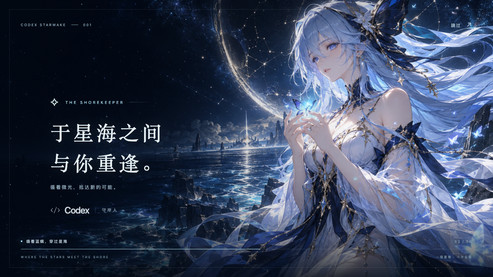

# Codex Starwake ✨

**A little starlight before your next creation.**

Cinematic startup animations for Codex on macOS.

[中文](README.md) · English



A 6.8-second introduction with fluttering blue butterflies, drifting stars, ocean ripples and a slow camera move. The default artwork is an AI-generated fan-art depiction of The Shorekeeper from Wuthering Waves.

[Watch the demo](docs/demo.mp4) · [Installation details](docs/INSTALL.md) · [Asset notice](NOTICE.md)

## How it works

A per-user helper starts at login and listens for macOS application-launch notifications. When an application with bundle identifier `com.openai.codex` starts, it plays the animation in a native WebKit window, then returns focus to Codex.

- Works when launching Codex from its original icon, Dock or Finder after quitting it.
- Switching windows or focusing an already running app does not replay the animation.
- No modifications to the official app, its signature or `app.asar`; no CDP port.
- Offline at runtime, without telemetry, remote fonts or account access. The idle helper waits for system events instead of polling.
- Escape or the Skip button dismisses the splash. A lock prevents overlapping animations.
- Disable, re-enable or uninstall at any time. Uninstall moves managed files to Trash.

This is a separate splash window, not an official built-in loading screen. The character is a still illustration; camera motion, butterflies, particles and lighting provide the animation. The progress bar represents animation time, not Codex readiness. The default animation's copy is currently in Chinese.

## Install

Requires **macOS 13+**, the Codex desktop app and **Apple Command Line Tools**. Supports Apple Silicon and Intel by compiling locally. Runtime installation does not require Node.js, Python or third-party Swift packages.

```sh
xcode-select --install  # Skip if Command Line Tools are already installed.

git clone https://github.com/Kizai/codex-starwake.git
cd codex-starwake
zsh scripts/install.sh
```

Wait for Command Line Tools installation to finish before running the project installer. Alternatively, download and extract the source ZIP, then double-click **Install.command**. Run as your normal user, without `sudo`.

Fully quit Codex and open it again to see the animation. Installation does not quit your existing session or immediately animate the already running app. Some Codex builds are displayed as ChatGPT; matching uses `com.openai.codex`, not the displayed name. An unrelated ChatGPT app with a different identifier is not matched.

### Preview

```sh
zsh scripts/preview.sh  # Native preview without opening Codex.
open web/index.html    # Browser preview: Space to replay, Escape to skip.
```

You can also double-click **Preview.command**. Browser preview works without a Swift compiler.

### Manage

```sh
zsh scripts/status.sh
zsh scripts/disable.sh
zsh scripts/enable.sh
zsh scripts/uninstall.sh
```

Double-click **Disable.command**, **Enable.command** or **Uninstall.command** for the same actions. Uninstall stops the helper and moves only the managed installation and LaunchAgent to Trash.

The installed copy is self-contained:

```text
~/Library/Application Support/Codex Starwake/
~/Library/LaunchAgents/io.github.kizai.codex-starwake.plist
```

You may move or remove the checkout after installation. Management commands remain in the installed directory. Update by pulling changes and rerunning the installer; reinstall replaces the installed animation with the source version.

## Customize

Replace `web/assets/shorekeeper.png`, retaining the filename, and rerun the installer. A roughly 16:9 image with a subject on the right and dark space on the left fits the composition. Edit copy in `web/index.html`, styling in `web/style.css`, and motion in `web/animation.js`. Use artwork you have permission to distribute and include its attribution. The current version ships one theme, without a theme marketplace or graphical selector.

## Develop

Development checks require Node.js 20+ and Command Line Tools:

```sh
zsh scripts/check.sh
npm ci
npx playwright install chromium
npm run test:browser
```

Installer tests use temporary paths and skip launchctl. Browser tests check seek, replay, skip, desktop/mobile layouts and external resource requests. Actual launch notifications, login behavior and window handoff require a real macOS desktop session; CI compilation alone does not verify them.

See [CONTRIBUTING.md](CONTRIBUTING.md) and [docs/INSTALL.md](docs/INSTALL.md) for details.

## License and credits

Original code and documentation use the [MIT License](LICENSE), retaining Kizai's copyright. The AI-generated fan-art illustration, screenshots and demo are separately identified in [NOTICE.md](NOTICE.md). Character, game, product and trademark rights belong to their respective owners. This is an independent project, without official affiliation or endorsement.

The implementation uses Swift / AppKit / WebKit and macOS launch events. No code was copied from Codex Dream Skin; thanks to that project for inspiration around personalized desktop experiences.
